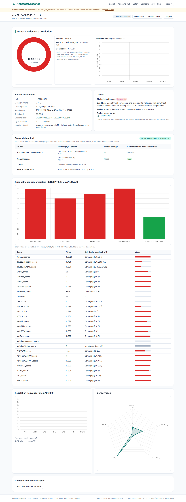

# AnnotateMissense Server

Web server, REST API and command-line tool for **AnnotateMissense** — precomputed GRCh38 missense
pathogenicity scores for 90,643,830 variants
([Zenodo 10.5281/zenodo.19981867](https://doi.org/10.5281/zenodo.19981867)).

- **Live demo:** <https://annotatemissense.vercel.app> (scores for all chr22 alleles; full reports for 15 chr22 genes)
- **Documentation:** <https://muhammadmuneeb007.github.io/AnnotateMissense/>
- **Pipeline / model code:** <https://github.com/MuhammadMuneeb007/AnnotateMissense>
- **This repository:** the software that serves the released database — lookups, VCF annotation, REST API, web UI.



## What it does

| Task | Web UI | REST API | Offline CLI |
|---|---|---|---|
| Look up one allele | Search page | `GET /api/v1/variant/22:36305985:G:A` | `annotatemissense lookup 22:36305985:G:A` |
| Look up a list (≤1,000) | Variant list tab | `POST /api/v1/batch` | `annotatemissense lookup --file list.txt` |
| Annotate a VCF | Annotate VCF page | `POST /api/v1/annotate?format=vcf` | `annotatemissense annotate-vcf in.vcf.gz -o out.vcf` |
| Browse a gene | Gene tab | `GET /api/v1/gene/MYH9` | — |
| Inspect schema / counts | — | `GET /api/v1/schema`, `/stats` | `annotatemissense schema`, `stats`, `audit` |

AnnotateMissense is a **precomputed lookup**: it scores GRCh38 single-nucleotide alleles that are in
the release. It does not re-run the model on new alleles, indels or other genome builds; those are
reported with an explicit status (`not_in_release`, `not_snv`), never as benign.

## Quick start

```bash
git clone https://github.com/MuhammadMuneeb007/AnnotateMissense-Server
cd AnnotateMissense-Server
python -m venv .venv && source .venv/bin/activate      # Windows: .venv\Scripts\activate
pip install -r requirements.txt
pip install -e .                                        # provides the `annotatemissense` command

# Data: the full annotation database (20.8 GB download)
wget -O data/variants.duckdb.gz "https://zenodo.org/records/19981867/files/variants.duckdb.gz?download=1"
gzip -d data/variants.duckdb.gz

annotatemissense serve --db data/variants.duckdb --port 8000     # http://127.0.0.1:8000
```

Light option (scores only, no annotations): download `UQ_BioSig_model_Final.tsv.gz` (1.4 GB) and build
a compact score index:

```bash
annotatemissense build-score-index UQ_BioSig_model_Final.tsv.gz -o data/annotatemissense_scores.duckdb
annotatemissense serve --scores data/annotatemissense_scores.duckdb
```

Docker:

```bash
docker compose up -d --build        # serves ./data/variants.duckdb on http://localhost:8080
```

## Offline VCF annotation (no upload)

```bash
annotatemissense annotate-vcf patient.vcf.gz -o patient.annotatemissense.vcf --db data/variants.duckdb
annotatemissense annotate-vcf patient.vcf.gz -o patient.annotatemissense.tsv --db data/variants.duckdb
```

Adds three per-ALT (`Number=A`) INFO fields: `AnnotateMissense_score` (0–1), `AnnotateMissense_pred`
(`D` ≥ 0.5 > `T`) and `AnnotateMissense_status` (`found` · `no_score` · `not_in_release` · `not_snv` ·
`invalid`). Multi-allelic records are scored per ALT; padded SNVs (`CG>CA`) are trimmed to `G>A`; a
GRCh37 header triggers a warning.

Measured on a laptop (Windows 11, DuckDB 1.5, chromosome-22 extract, 1.68 M rows): single lookup
≈0.1 s via the API; 100,000-allele VCF ≈11 s with the CLI.

## Configuration

| Variable | Default | Meaning |
|---|---|---|
| `ANNOTATEMISSENSE_DB` | `data/variants.duckdb` → `data/variants_dev.duckdb` | annotation database |
| `ANNOTATEMISSENSE_SCORES` | `data/annotatemissense_scores.duckdb` if present | score index |
| `MAX_BATCH_VARIANTS` | 1000 | batch endpoint limit |
| `MAX_VCF_ALLELES` | 10000 | ALT alleles per VCF upload |
| `MAX_UPLOAD_MB` | 50 | request size limit |
| `RATE_LIMIT` | `300/hour` | per-IP limit for API endpoints |
| `TRUST_PROXY` | 0 | set 1 behind nginx / Cloudflare |
| `INSTANCE_NOTE` | — | text appended to the demo banner |

## Repository layout

```
annotatemissense/   core library (DuckDB only): db.py lookups, vcf.py annotation, cli.py
app/                Flask web UI and REST API (templates, static JS/CSS)
tests/              pytest suite on a 146-row extract of the release (tests/data)
scripts/            take_screenshots.py (Playwright); build_demo_data.py (demo/ data)
demo/               bundled chr22 demo data used by the hosted instance when no data/ is configured
docs/screenshots/   screenshots of the running server
```

Run the tests with `pip install pytest && pytest`.

## Naming

The released files keep historical names: the database columns `UQ_score`, `UQ_sd`, `UQ_pred` and
the table `UQ_BioSig_model_Final.tsv.gz` are the AnnotateMissense score, confidence and prediction.
This software exposes them as `annotatemissense_score`, `annotatemissense_confidence`,
`annotatemissense_pred`. `UQ_sd`/`sd` is the probability of the predicted class,
max(score, 1 − score), not a standard deviation.

## Licence and data use

See the [licensing page](https://muhammadmuneeb007.github.io/AnnotateMissense/licensing/). The
database embeds third-party annotations (dbNSFP components, ANNOVAR-distributed databases,
AlphaMissense, ClinVar, gnomAD) that keep their own terms, some non-commercial. Scores are for
research prioritisation, not clinical decision-making.

## Citation

Muneeb M, Ascher DB. *AnnotateMissense: a genome-wide annotation and benchmarking framework for
missense pathogenicity prediction.* Data: doi:10.5281/zenodo.19981867.
